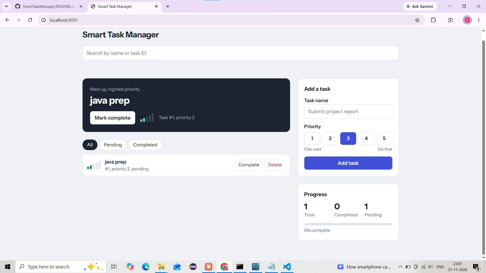

# Smart Task Management System


A task manager built with Java, JDBC and MySQL, with a web interface.
Tasks are prioritised, so the app always shows what to work on next.

## Features
- Add, search, complete and delete tasks
- Priority levels from 1 (can wait) to 5 (do first)
- "Next up" panel that shows the highest-priority pending task
- Progress panel with total, completed and pending counts

## Tech stack
Java, JDBC, MySQL, HTML/CSS/JavaScript, Java built-in HTTP server

## Project structure
- `ApiServer.java`: web server and REST API, also serves the frontend
- `frontend/index.html`: user interface
- `TaskManager.java`, `Task.java`, `Main.java`: original console version
- `DBConnection.java`: database connection (password read from `DB_PASSWORD`)

## Database
Database `taskmanager`, table `tasks`:

```sql
CREATE TABLE tasks (
  id INT PRIMARY KEY,
  name VARCHAR(100),
  priority INT,
  status VARCHAR(20)
);
```

## How to run (Windows PowerShell)
```
$env:DB_PASSWORD="your-mysql-password"
javac -cp ".;lib/mysql-connector-j-9.7.0.jar" *.java
java -cp ".;lib/mysql-connector-j-9.7.0.jar" ApiServer
```
Then open `http://localhost:8081` in your browser (works only while the server is running on your computer).

## Author
Swathi Chilla
